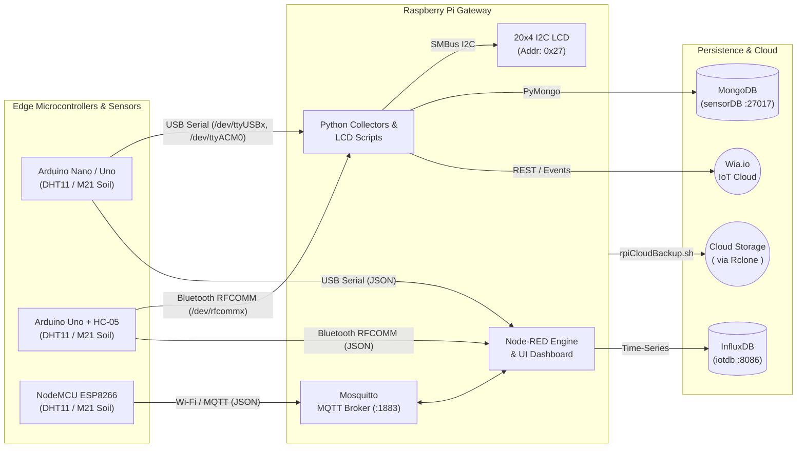

# 🍓 Raspberry Pi, Arduino & ESP8266 IoT Ecosystem

[](https://www.gnu.org/licenses/gpl-3.0)
[](https://www.python.org/)
[](https://www.arduino.cc/)
[](https://www.espressif.com/)
[](https://nodered.org/)
[](https://www.gnu.org/software/bash/)

An end-to-end collection of **Python scripts**, **Bash system administration & automation utilities**, **Arduino / ESP8266 (NodeMCU) firmware sketches**, **I2C LCD drivers**, and **Node-RED dashboard flows** designed to turn a Raspberry Pi into a central home-automation, environmental telemetry, and IoT gateway hub.

---

## 📑 Table of Contents

1. [System Architecture](#-system-architecture)
2. [Repository Structure](#-repository-structure)
3. [Hardware & Pinout Reference](#-hardware--pinout-reference)
4. [Python Scripts (IoT Cloud, Databases & I2C LCD)](#-python-scripts-iot-cloud-databases--i2c-lcd)
5. [Bash Administration & Automation Scripts](#-bash-administration--automation-scripts)
6. [Node-RED Dashboard & Telemetry Flows](#-node-red-dashboard--telemetry-flows)
7. [Arduino & ESP8266 (NodeMCU) Sketches](#-arduino--esp8266-nodemcu-sketches)
8. [Getting Started & Prerequisites](#-getting-started--prerequisites)
9. [License](#-license)

---

## 🏗 System Architecture

The repository implements a multi-transport sensor network where microcontrollers (**Arduino Uno**, **Arduino Nano**, and **ESP8266 NodeMCU**) collect indoor, outdoor, and plant soil telemetry and transmit it to a **Raspberry Pi** over **USB Serial**, **Bluetooth (HC-05 RFCOMM)**, or **Wi-Fi (MQTT)** for local visualization, database persistence, and cloud publishing.



---

## 📂 Repository Structure

```text
raspberry-pi/
├── DHT11setup/
│   └── DHT11setup.ino                      # Basic DHT11 serial test sketch (Pin 9, 115200 baud)
├── dht11JSON/
│   └── dht11JSON.ino                       # DHT11 to USB Serial in JSON format (Pin 11, 9600 baud)
├── dht11toBT/
│   ├── dht11toBT.ino                       # On-demand ('m') DHT11 over HC-05 Bluetooth (CSV output)
│   └── workingSketch_Sending-DHT11-data_Over-BT-HC-05.txt
├── dht11toBTJSON/
│   └── dht11toBTJSON.ino                   # On-demand ('m') DHT11 over HC-05 Bluetooth (JSON output)
├── helloWorldMorseCode/
│   └── helloWorldMorseCode.ino             # Blinks "HELLO" (Pin 11), "WORLD" (Pin 10), Reset (Pin 9) in Morse
├── ledTests/
│   └── ledTests.ino                        # Sequential 5-LED hardware test (Pins 9–13)
├── moistureSensorM21/
│   └── moistureSensorM21.ino               # M21 soil moisture sensor to USB Serial in JSON (Pin A0)
├── moistureSensorM21BT/
│   └── moistureSensorM21BT.ino             # M21 soil moisture sensor to HC-05 Bluetooth in JSON (Pin A0)
├── NodeMcuWifiMqttDht11Json/
│   └── NodeMcuWifiMqttDht11Json.ino        # ESP8266 Wi-Fi MQTT publisher/subscriber for DHT11 (Pin D0)
├── NodeMcuWifiMqttM21Json/
│   └── NodeMcuWifiMqttM21Json.ino          # ESP8266 Wi-Fi MQTT publisher for M21 moisture sensor (Pin A0)
├── debian-w-docker-postinstall.sh          # Debian server post-install & Docker CE setup script
├── display_clocks.py                       # 20x4 I2C LCD world clock (Local/Paris/Sydney) + DHT11 telemetry
├── display_infos.py                        # 20x4 I2C LCD network monitor (LAN/WAN IP) + DHT11 telemetry
├── I2C_LCD_driver.py                       # SMBus I2C driver library for HD44780 20x4 / 16x2 LCDs
├── liveDns.sh                              # Gandi LiveDNS v5 dynamic DNS (DDNS) A-record updater
├── Node-RED-environment_flows.json         # Complete Node-RED flow for MQTT, Serial, InfluxDB & UI Gauges
├── off.py                                  # Process killer & clean backlight shutdown for the I2C LCD
├── rpiCloudBackup.sh                       # Tar.gz backup automation with Rclone cloud sync
├── rpiGetArduinoNanoSerialToWiaIO.py       # USB Serial DHT11 reader & Wia.io cloud event publisher
├── rpiGetArduinoUnoSerialBTtoWiaIO.py      # Bluetooth RFCOMM DHT11 reader & Wia.io cloud event publisher
├── rpiNetbiosScanHostsUpdate.sh            # Local NetBIOS scanner (nbtscan) to auto-populate /etc/hosts
├── rpiPostArduinoSerialDatatoMongoDB.py    # Serial DHT11 reader & MongoDB document logger
├── .gitignore                              # Git ignore rules (Python cache & Wia token_file*)
└── LICENSE                                 # GNU General Public License v3.0
```

---

## 🔌 Hardware & Pinout Reference

### Microcontroller Pin Assignments

| Sketch / Module | Target Board | Sensor / Actuator | Data / Signal Pins | Communication Interface |
| :--- | :--- | :--- | :--- | :--- |
| `DHT11setup` | Arduino Uno / Nano | DHT11 Temp & Humidity | Digital `D9` | Hardware Serial (`115200` baud) |
| `dht11JSON` | Arduino Uno / Nano | DHT11 Temp & Humidity | Digital `D11` | Hardware Serial (`9600` baud) |
| `dht11toBT` | Arduino Uno | DHT11 + HC-05 Bluetooth | DHT11: `D9`<br/>HC-05: `D10` (RX), `D11` (TX) | `SoftwareSerial` (`9600` baud) |
| `dht11toBTJSON` | Arduino Uno | DHT11 + HC-05 Bluetooth | DHT11: `D9`<br/>HC-05: `D10` (RX), `D11` (TX) | `SoftwareSerial` (`9600` baud) |
| `moistureSensorM21` | Arduino Uno / Nano | M21 Soil Moisture Sensor | Analog `A0` | Hardware Serial (`9600` baud) |
| `moistureSensorM21BT` | Arduino Uno / Nano | M21 + HC-05 Bluetooth | M21: `A0`<br/>HC-05: `D10` (RX), `D11` (TX) | `SoftwareSerial` (`9600` baud) |
| `NodeMcuWifiMqttDht11Json` | NodeMCU 1.0 (ESP-12E) | DHT11 Temp & Humidity | Digital `D0` (`GPIO16`) | Wi-Fi + MQTT (`1883`) & Serial (`115200`) |
| `NodeMcuWifiMqttM21Json` | NodeMCU 1.0 (ESP-12E) | M21 Soil Moisture Sensor | Analog `A0` (`ADC0`) | Wi-Fi + MQTT (`1883`) & Serial (`115200`) |
| `helloWorldMorseCode` | Arduino Uno / Nano | 3x LEDs | `D11` ("HELLO"), `D10` ("WORLD"), `D9` (Reset) | Digital GPIO Output |
| `ledTests` | Arduino Uno / Nano | 5x LEDs | Digital `D9`, `D10`, `D11`, `D12`, `D13` | Digital GPIO Output |

### Raspberry Pi I2C LCD Wiring (`I2C_LCD_driver.py`)

* **I2C Address**: `0x27` (configurable via `ADDRESS` in `I2C_LCD_driver.py`)
* **I2C Bus Port**: `1` (`/dev/i2c-1`)
* **Connections**: `SDA` → GPIO 2 (Pin 3), `SCL` → GPIO 3 (Pin 5), `VCC` → 5V (Pin 2/4), `GND` → GND (Pin 6)

---

## 🐍 Python Scripts (IoT Cloud, Databases & I2C LCD)

### 1. I2C LCD Display Suite

* **`I2C_LCD_driver.py`**  
  Low-level SMBus driver combining `i2c_device` and `lcd` classes for HD44780-based 20x4 and 16x2 character LCDs.
  * Key methods: `lcd_display_string(string, line)`, `lcd_display_string_2(string, string2, line)`, `lcd_display_string_pos(string, line, pos)`, `lcd_clear()`, `backlight(state)`, and `lcd_load_custom_chars(fontdata)`.

* **`display_clocks.py`**  
  Continuously reads `temp,hum` data from an Arduino over `/dev/ttyUSB0` (`9600` baud) and updates a 4-line 20x4 I2C LCD with multi-timezone clocks and indoor climate telemetry:
  * **Line 1**: Local system time (`HH:MM:SS`)
  * **Line 2**: Paris time (`Europe/Paris`)
  * **Line 3**: Sydney time (`Australia/Sydney`)
  * **Line 4**: Temperature & Humidity (`Tc = XX H% = YY`)

* **`display_infos.py`**  
  System and network status dashboard on a 4-line 20x4 I2C LCD paired with live serial sensor readings from `/dev/ttyUSB0`:
  * **Line 1**: Local system time (`HH:MM:SS`)
  * **Line 2**: Local wireless IP address (`wlan0`) resolved via `socket` and `fcntl.ioctl` (`0x8915` / `SIOCGIFADDR`)
  * **Line 3**: Public WAN IP address fetched from `https://api.ipify.org`
  * **Line 4**: Temperature & Humidity (`Tc = XX H% = YY`)

* **`off.py`**  
  Safe shutdown utility for the I2C LCD screen. Because only one process should access the I2C LCD bus at a time, `off.py`:
  1. Searches running processes (`ps aux`) for any active `display_*` script.
  2. Extracts its PID and terminates the process (`kill -9 <PID>`).
  3. Clears the LCD display (`mylcd.lcd_clear()`) and powers off the backlight (`LCD_NOBACKLIGHT = 0x00`).

---

### 2. Wia.io Cloud Publishers

Both Wia.io scripts read an API access token from a local JSON file (`token_file.json` or `token_file_2.json`, excluded from Git via `.gitignore`) formatted as:
```json
{
  "token": "d_sk_your_wia_device_secret_key"
}
```

* **`rpiGetArduinoNanoSerialToWiaIO.py`**  
  Opens a USB serial connection on `/dev/ttyUSB0` (`9600` baud), flushes the input buffer, waits for a valid reading containing both temperature and humidity, and publishes separate `Temperature` and `Humidity` events to the [Wia.io](https://www.wia.io/) cloud broker (with a 5-second interval and commented support for `wia.Location.publish`).

* **`rpiGetArduinoUnoSerialBTtoWiaIO.py`**  
  Connects to an HC-05 Bluetooth module bound to `/dev/rfcomm0` (`9600` baud), sends the single-byte command `'m'` to request an on-demand measurement from the Arduino Uno (running `dht11toBT.ino`), parses the response, and publishes `Temperature` and `Humidity` events to Wia.io.

---

### 3. MongoDB Telemetry Logger

* **`rpiPostArduinoSerialDatatoMongoDB.py`**  
  Reads a temperature and humidity pair from `/dev/ttyUSB0` (or `/dev/rfcomm0` by uncommenting line 30) and inserts two timestamped documents into a local MongoDB instance (`127.0.0.1:27017`, database: `sensorDB`, collection: `sensor_data`):
  ```json
  { "Sensor_ID": "Nano", "Temperature": "22", "Datetime": "2019-08-19 14:30" }
  { "Sensor_ID": "Nano", "Humidity": "48", "Datetime": "2019-08-19 14:30" }
  ```

---

## 💻 Bash Administration & Automation Scripts

| Script | Purpose | Key Features & Usage |
| :--- | :--- | :--- |
| **`debian-w-docker-postinstall.sh`** | Server Provisioning & Docker Setup | Automated post-install script for Debian (tested on 8.7 & 9.4 x64, AWS EC2 & DigitalOcean).<br/>• Upgrades base packages and installs administration/network utilities (`vim`, `net-tools`, `curl`, `htop`, `strace`, `sysstat`, `whois`, `dnsutils`, `rblcheck`, etc.).<br/>• Installs and configures `chkrootkit` for quiet daily scans.<br/>• Verifies Docker's official GPG key fingerprint (`9DC858229FC7DD38854AE2D88D81803C0EBFCD88`) before installing `docker-ce`.<br/>• Creates `/root/env_vars` with aliases (`ll`, `l`, `full-docker-list`) and dynamic environment variables (`$wan`, `$lan`, `$dns`). |
| **`liveDns.sh`** | Gandi LiveDNS v5 DDNS Client | Updates a domain/subdomain `A` record with the host's current dynamic public IP (`api.ipify.org`).<br/>• Built using standard UNIX tools (`wget`, `curl`, `awk`, `sed`) with optional `jq` support.<br/>• Compares the current ISP IP against Gandi's DNS record before issuing a `PUT` request (`TTL: 1200`).<br/>• Logs updates and unchanged checks to `logs.log` (ideal for cron scheduling). |
| **`rpiCloudBackup.sh`** | Rclone Cloud Backup Automation | Archives local directories into date-stamped `.tar.gz` files (`YYYY-MM-DD-folder.tar.gz`) in `$HOME/local_backup` and syncs them to cloud storage (Google Drive, Dropbox, etc.) via `rclone copy`.<br/>• Includes first-run configuration checks (`dirtobackup1`, `remotebackupdir`).<br/>• Prompts to re-run with `sudo` if not executed as `root` (to preserve access to `/etc`, `/var/www`, `/root`).<br/>• Cleans up temporary local archives after cloud upload completes. |
| **`rpiNetbiosScanHostsUpdate.sh`** | NetBIOS Cluster Host Discovery | Acts as a lightweight, zero-DNS local name resolution updater for Raspberry Pi clusters using `nbtscan`.<br/>• Scans a configured subnet range (`nbtscan -q -e <network>`).<br/>• Rebuilds `/etc/hosts` cleanly with loopback/IPv6 defaults, gateway entry, and discovered NetBIOS hosts. |

---

## 📊 Node-RED Dashboard & Telemetry Flows

**`Node-RED-environment_flows.json`** provides a ready-to-import Node-RED workspace (`Environment` tab) and a custom dark-themed **Node-RED Dashboard** (`Room Environment`).

### Configured Data Pipelines

1. **Room Thermometer Indoor Workflow (`/dev/ttyUSB1`)**
   * Reads JSON strings (`{"Temperature":XX,"Humidity":YY}`) from USB Serial `/dev/ttyUSB1` (`9600` baud).
   * Displays live wave gauges in the **Room current measures** dashboard group (`Indoor Temperature` in `°C`, `Indoor Humidity` in `%`).
   * Publishes values to the local Mosquitto MQTT broker (`127.0.0.1:1883`) under topics `Temperature` and `Humidity`.
   * Subscribes to those MQTT topics, casts payloads to floats, and writes time-series points to **InfluxDB** (`127.0.0.1:8086`, database `iotdb`, measurements `Temperature` and `Humidity`).

2. **Plant Pot 1 Soil Moisture Workflow (`/dev/ttyACM0` & `/dev/rfcomm1`)**
   * Reads JSON soil moisture payloads (`{"Raw":XXX,"Percentage":YY}`) from `/dev/ttyACM0` (`9600` baud).
   * Renders the `Plant humidity pot 1` wave gauge (`0–100%`) under **Plants humidity measures**.
   * Publishes to MQTT topic `Plants Humidity` and stores measurements in InfluxDB (`PlantHumidity`).

3. **External Thermometer NodeMCU Workflow (MQTT `extTemperature`)**
   * Subscribes to MQTT topic `extTemperature` (published over Wi-Fi by `NodeMcuWifiMqttDht11Json.ino`).
   * Parses the JSON payload to feed two outdoor wave gauges (`Outside Temperature` and `Outside Humidity`) under **Outside current measures**.
   * Persists both metrics to InfluxDB under measurements `ExternalTemperature` and `ExternalHumidity`.

### Importing the Flow
1. Open your Node-RED editor (`http://<raspberry-pi-ip>:1880`).
2. Install required palette nodes if not already present:
   ```bash
   cd ~/.node-red
   npm install node-red-dashboard node-red-node-serialport node-red-contrib-influxdb
   ```
3. Click **Menu (☰) → Import → Select a file to import** and choose `Node-RED-environment_flows.json`.

---

## 🤖 Arduino & ESP8266 (NodeMCU) Sketches

### Environmental Sensors (DHT11)

* **`DHT11setup/DHT11setup.ino`**  
  Hardware verification sketch using `<dht.h>`. Reads a DHT11 sensor on Digital Pin `9` every 2.5 seconds and outputs human-readable lines (`Temperature = XX` / `Humidity = YY`) over Serial at `115200` baud.

* **`dht11JSON/dht11JSON.ino`**  
  Reads a DHT11 sensor on Digital Pin `11` every 5 seconds and prints compact JSON over USB Serial (`9600` baud):
  ```json
  {"Temperature":23.00,"Humidity":45.00}
  ```

* **`dht11toBT/dht11toBT.ino`**  
  Uses Adafruit's `"DHT.h"` (Pin `9`) and `<SoftwareSerial.h>` (RX `10`, TX `11` at `9600` baud) with an HC-05 Bluetooth module. Idles until it receives the character `'m'` over Bluetooth, then replies with `<temperature>,<humidity>` (e.g., `23,45`).

* **`dht11toBTJSON/dht11toBTJSON.ino`**  
  Combines `<dht.h>` (Pin `9`) and `<SoftwareSerial.h>` (RX `10`, TX `11` at `9600` baud). Waits for the `'m'` trigger byte over Bluetooth and responds with a JSON payload (`{"Temperature":23.00,"Humidity":45.00}`).

* **`NodeMcuWifiMqttDht11Json/NodeMcuWifiMqttDht11Json.ino`**  
  Firmware for **NodeMCU 1.0 (ESP-12E)** using `<ESP8266WiFi.h>`, `<PubSubClient.h>`, and `<dht.h>`:
  * Connects to Wi-Fi and a Mosquitto MQTT broker (`1883`).
  * Reads DHT11 on pin `D0` every 6 seconds and publishes JSON (`{"Temperature":XX,"Humidity":YY}`) to MQTT topic `extTemperature`.
  * Subscribes to MQTT topic `nodemcu` for interactive remote queries: payload `0` prints JSON humidity to Serial; payload `1` prints JSON temperature.

---

### Soil Moisture Sensors (M21)

* **`moistureSensorM21/moistureSensorM21.ino`**  
  Reads analog soil moisture from pin `A0` every 500 ms, maps the calibrated raw ADC range (`dryValue = 320` to `wetValue = 670`) to `0–100%`, and outputs JSON over USB Serial (`9600` baud):
  ```json
  {"Raw":512,"Percentage":54}
  ```

* **`moistureSensorM21BT/moistureSensorM21BT.ino`**  
  Identical calibration and JSON output to `moistureSensorM21.ino`, transmitted wirelessly every 500 ms via an HC-05 Bluetooth module on `SoftwareSerial` pins `10` (RX) and `11` (TX) at `9600` baud.

* **`NodeMcuWifiMqttM21Json/NodeMcuWifiMqttM21Json.ino`**  
  ESP8266 NodeMCU firmware that reads the M21 analog sensor on `A0` every 6 seconds, maps the 10-bit ESP8266 ADC range (`dryValue = 1024` to `wetValue = 38`) to `0–100%`, and publishes JSON (`{"Raw":XXX,"Percentage":YY}`) to MQTT topic `Plants Humidity 2`.

---

### Diagnostic & Educational Sketches

* **`helloWorldMorseCode/helloWorldMorseCode.ino`**  
  Blinks `"HELLO"` in Morse code on Digital Pin `11` (`.... . .-.. .-.. ---`), `"WORLD"` in Morse code on Digital Pin `10` (`.-- --- .-. .-.. -..`), followed by 4 synchronization blinks on Digital Pin `9`.

* **`ledTests/ledTests.ino`**  
  Cycles through Digital Pins `13`, `12`, `11`, `10`, and `9` with varying pulse durations (`50 ms` to `1500 ms`) to test breadboard LED wiring. *(Note: before compiling in Arduino IDE, fix the intentional/minor typos on lines 33–34: change `digitalWrit(9, LOW);` to `digitalWrite(9, LOW);` and add a trailing `;` after `delay(100)`).*

---

## 🚀 Getting Started & Prerequisites

### 1. Raspberry Pi System Packages
Enable I2C on your Raspberry Pi (`sudo raspi-config` → **Interface Options** → **I2C**) and install the required system dependencies:

```bash
sudo apt-get update
sudo apt-get install -y python3-pip python3-smbus i2c-tools bluetooth bluez-tools nbtscan rclone mosquitto mongodb influxdb
```

### 2. Python Dependencies
Install the Python libraries used across the serial, cloud, database, and LCD scripts:

```bash
pip3 install pyserial pytz simplejson wia pymongo
```

### 3. Binding Bluetooth Serial (HC-05)
For scripts and flows using `/dev/rfcomm0` or `/dev/rfcomm1`, pair your HC-05 module and bind it to an RFCOMM device:

```bash
sudo rfcomm bind 0 <HC-05-MAC-ADDRESS> 1
```

### 4. Arduino IDE Libraries
To compile and upload the `.ino` sketches, install the following libraries in the Arduino IDE:
* **DHTlib** (`<dht.h>`) or **Adafruit DHT sensor library** (`"DHT.h"`)
* **PubSubClient** by Nick O'Leary (for MQTT on NodeMCU)
* **ESP8266 Board Package** (`http://arduino.esp8266.com/stable/package_esp8266com_index.json`)

---

## 📜 License

This project is licensed under the **GNU General Public License v3.0 (GPL-3.0)** — see the [LICENSE](LICENSE) file for full details.
